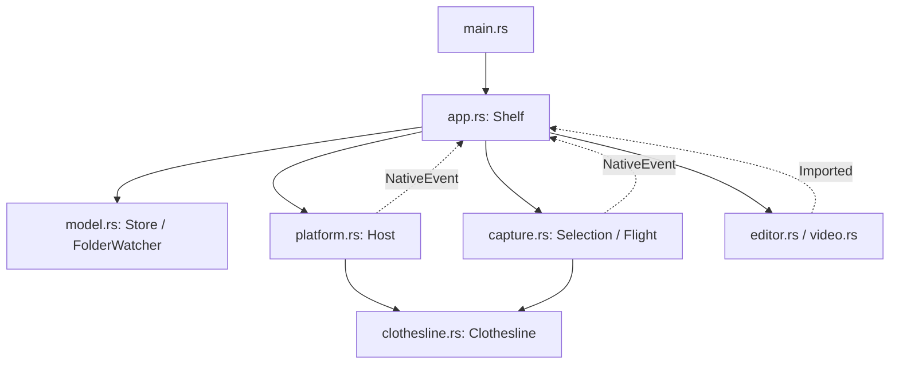
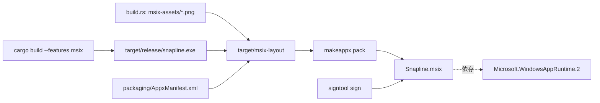

# Snapline のアーキテクチャ

Windows 版の機能追加・修正に向けた構成案内。実装方針は [AGENTS.md](AGENTS.md)、操作・配布・実機検証の手順は [README.ja.md](README.ja.md) を参照する。
この文書は現在の実装を説明する。GDI 禁止・WinRT 優先という今後の実装方針と、既存の API 依存は区別して記載している。

## ファイルの役割

パスはリポジトリのルートからの相対パス。Rust モジュールは単一の実行ファイルにまとめられ、テストは各モジュール内に置かれている。

| ファイル | 役割と主な関連先 |
| --- | --- |
| `src/main.rs` | エントリーポイント。保存先の決定、Store の読み込み確認、多重起動の抑止、ログと panic hook、OLE の初期化、Reactor の `Shelf` 起動。 |
| `src/app.rs` | アプリ全体の状態と操作を管理する `Shelf` / `Message`。設定 UI、取り込み、ページ切り替え、監視、キャプチャ、飛来、編集画面への振り分けを担当する。 |
| `src/model.rs` | `Settings`、`Item`、`Store`、`FolderWatcher`。設定・一覧の永続化、メディアのコピー、画像の重複判定、固定・取り外し・復元、監視対象ファイルの安定判定。 |
| `src/platform.rs` | Windows との接続。`Host`、`NativeEvent`、通知領域とそのネイティブメニュー、写真の右クリックメニュー `item_menu`、ホットキー、タイマー、ダイアログ、クリップボード、OLE ドラッグ、外部アプリの起動（`open` / `edit`）、モニター情報、前面全画面の判定 `fullscreen_foreground`、キャプチャ、単一起動、ファイル置換、実行ファイルの隣のアイコン `icon_path`。`Host` が `Clothesline` を所有する。 |
| `src/clothesline.rs` | 透明な棚ウィンドウと Composition の描画基盤。ロープ・写真・額縁・クリップ、レイアウトと DPI、揺れ・表示切り替え、入力判定。キャプチャ側に Compositor、画像描画、着地点 `Landing` を提供する。 |
| `src/capture.rs` | `Selection` による固定画面上の矩形選択と切り出し、`Flight` による撮影位置から棚への飛来。オーバーレイのウィンドウと Visual を所有する。 |
| `src/screen_capture.rs` | Windows.Graphics.Capture による一回の画面取得。MTA スレッドでモニターごとのフレームを Direct3D 11 で読み戻し、物理座標で RGBA 画像に合成する。`platform::capture_rect` から呼ばれる。 |
| `src/editor.rs` | WinUI の画像編集画面。ペン・四角・切り抜き・Undo と、`media/` 直下への `{一意な ID}-edited.png` の保存。`EditorInput` の保存通知を通じて `app.rs` に取り込みを依頼する。 |
| `src/video.rs` | WinUI の動画トリミング画面。`Windows.Media.Editing` で長さ取得・切り出し・`media/` 直下への `{一意な ID}-trimmed.mp4` 出力をバックグラウンド実行し、保存結果を `app.rs` に通知する。 |
| `Cargo.toml` | Rust の依存関係、Windows API の feature、ビルドプロファイル、`msix` feature。`windows-reactor` と setup を同じ固定バージョンで使用する。 |
| `Cargo.lock` | 解決済みの依存バージョン。再現可能なビルドのために保持する。 |
| `build.rs` | ビルドモデルの切り替え（自己完結 / `msix`）、Windows App Runtime の自己完結配置、独自アイコン `snapline.ico` と MSIX 用ロゴ PNG の生成。Cargo から自動実行される。 |
| `scripts/run-windows.ps1` | 開発用。対象チェックアウトの実行プロセスを停止し、オフラインで Debug ビルドして起動する。`-Test` / `-SlowFlight` / `-TargetDir` を受け付ける。自己完結ビルドを使う。 |
| `scripts/build-windows.ps1` | 配布用。`--features msix` の Release ビルドを `packaging/AppxManifest.xml` と組み合わせ、MSIX の作成・署名・動作確認用の登録まで行う。 |
| `packaging/AppxManifest.xml` | MSIX のパッケージマニフェスト雛形。ビルドスクリプトがバージョン・発行元・アーキテクチャを差し替える。フレームワーク依存と仮想化の設定はここだけで決まる。 |
| `README.ja.md` | Windows 版の利用方法、セットアップ、ビルド・配布、機能と制約、検証手順。 |
| `Architecture.md` | ファイル一覧と、複数モジュールを横断する構造・処理・変更時の注意点。 |
| `AGENTS.md` | 開発時の API 選択と、この文書を実装に追随させるためのルール。 |
| `LICENSE` | 元プロジェクトの MIT ライセンス、著作権表示、名前・アイコンに関する条件。 |
| `.gitignore` | ビルド成果物、ランタイムキャッシュ、動作確認用データなどの除外。 |

### 元の macOS プロジェクト由来の残存ファイル

`Package.swift` と `Sources/Tendedero` は削除されている。以下は現在も残っているが、Windows 版の Cargo ビルドからは使用しない。削除済みのソースや資材への参照があり、現行の開発手順としては扱わない。

| ファイル / ディレクトリ | 元の用途 |
| --- | --- |
| `scripts/build-app.sh` | macOS アプリのビルド・バンドル作成。 |
| `scripts/make-dmg.sh` | macOS 配布用 DMG の作成。 |
| `scripts/make-icon.swift` | macOS アプリアイコンの生成。Windows のアイコンは `build.rs` で生成する。 |
| `scripts/make-dmg-background.swift` | DMG の背景画像生成。 |
| `scripts/make-readme-art.swift` | 元プロジェクトの README 用画像生成。 |
| `scripts/check-strings.swift` | macOS の翻訳文字列の検査。 |
| `docs/i18n/README.*.md` | 元プロジェクトの各言語版 README。ルートの `README.ja.md` とは別の文書。 |
| `docs/images/` | 元プロジェクトの説明画像・GIF と言語別の画像。Windows の実行時リソースではない。 |

## 全体の構成と所有権

`main.rs` が起動する Reactor のルート Component は `app.rs::Shelf`。この WinUI ウィンドウは設定画面であり、写真が並ぶ透明な棚は別ウィンドウである。XAML ファイルは使わず Rust で UI を組み立てる。



実線は主な所有・利用関係、点線は通知を示す。`Shelf` は Store、監視状態、Host、選択中の Selection、飛来中の Flight を持つ。Host は設定 HWND と `RefCell<Clothesline>` を保持する。

ネイティブ側の操作は `platform::emit(NativeEvent)` から登録済みコールバック、Reactor の `LocalSender`、`Message::Native` を経由して Shelf に戻る。UI 状態と Composition オブジェクトは UI スレッドで扱う。動画の処理は Reactor の `spawn_background` で実行し、結果のメッセージだけを UI に返す。動画処理用スレッドでは COM apartment の初期化・解放を行う。

完全な一方向のレイヤー構成ではない。`platform.rs` が棚を所有する一方、棚・キャプチャから platform のイベントや画面情報を利用する。また、`model.rs` は platform の既知フォルダー取得・ファイル置換に依存し、platform は model の共通結果型を利用する。分割や置き換えの際は両方向を確認する。

Host の接続は同一スレッドのトップレベルウィンドウを走査し、タイトルが `Snapline` と完全一致するものを探す。設定ウィンドウのタイトル変更は `app.rs` と `platform.rs` を同時に確認する。終了時は Selection、Flight、Host の順に解放し、撮影用 Visual が棚より先に破棄されるようにする。Host はタイマー、ホットキー、通知領域アイコン、サブクラス、スレッドローカルのコールバックを後始末する。ただし `attach` の途中（アイコンの読み込み、通知領域の登録、`Clothesline::new`）で失敗すると `Host` が構築されず、登録済みのタイマー・ホットキー・サブクラスは解除されない。通知領域の登録を Windows が拒否する場合はこの経路に入り、棚は立ち上がらない。

## 矩形キャプチャから着地まで

1. `platform.rs` が Ctrl+Alt+S のホットキーを `NativeEvent::Capture` として通知し、`app.rs` が `Selection::start` を呼ぶ。設定 UI からの範囲撮影も同じ選択処理へ入る。
2. `capture.rs` は `platform::desktop_rect` / `capture_rect` で仮想デスクトップ全体を取得する。`platform::capture_rect` は `screen_capture.rs` の Windows.Graphics.Capture に委譲する。選択用オーバーレイを出す前の画像を固定し、その上に暗幕・枠・案内を表示する。
3. ドラッグを正規化し、選択完了の画面座標をアプリへ通知する。`Selection::crop` が保持済み画像から切り出す。Esc、右クリック、フォーカス喪失などはキャンセルになる。
4. `app.rs::captured` が `Store::add_image` で保存する。重複画像なら既存の ID を使い、対象モニター・ページ・表示容量を調整して棚を同期する。
5. `Clothesline::landing` が同期済みの写真の位置・大きさ・傾き・Visual を返す。`Flight::start` はこれを着地点として使い、撮影矩形から写真を移動・縮小する。飛来の準備中は固定画面を保持する。
6. 移動は 650 ms の cubic ease-in/out で、上向き 30 pt × 倍率の弧を描く。額縁とクリップの不透明度は進行 35% から立ち上がり、最後の 120 ms で棚の写真へクロスフェードする。棚側の対象写真は飛来との二重表示を避けるために一時的に透明にする。
7. アプリの Tick で完了を判定し、Flight を解放する。Drop は対象写真の不透明度を復元し、オーバーレイを片付ける。途中終了や失敗時もこの後始末が必要になる。

OS の Snipping Tool、撮影領域メタデータ、クリップボードを介する処理ではない。外部アプリから取り込んだ画像には撮影座標がないため、この飛来経路には入らない。

撮影前の棚の非表示化と 400 ms の固定待ちはない。棚が撮影範囲にあれば画像に含まれる。選択中・飛来中はアプリが受け付けるメッセージを制限し、監視による取り込みや自動非表示、通常の棚再同期が着地点を変更しないようにしている。タイミングの変更では `app.rs`、`capture.rs`、`clothesline.rs` の三者を確認する。

### Windows.Graphics.Capture の画面取得

範囲選択の固定画面と `app.rs::Message::Capture` のモニター撮影は同じ `platform::capture_rect` を使う。呼び出しは同期で、画像を受け取ってから選択・飛来の Composition オブジェクトを UI スレッドで作る。取得処理中は UI スレッドが結果を待つ。

`screen_capture::capture_rect` は一時 MTA スレッドを起動し、WinRT の初期化とスレッド単位の Per-Monitor V2 DPI 設定を行う。`EnumDisplayMonitors` で撮影矩形と交わるモニターを列挙し、`IGraphicsCaptureItemInterop::CreateForMonitor` で各 `HMONITOR` を WinRT の `GraphicsCaptureItem` に接続する。この列挙と COM interop は既存デスクトップモニターを指定する境界であり、GDI の DC・Bitmap・画面転送 API は使わない。

BGRA 対応の D3D11 デバイス（ハードウェア初期化失敗時は WARP）を DXGI / WinRT interop で `IDirect3DDevice` に変換する。モニターごとに `Direct3D11CaptureFramePool::CreateFreeThreaded` を作り、すべてのセッションを開始してから最初のフレームを受け取る。`FrameArrived` はフレームプール内部のスレッドで発火し、容量 1 のチャネルでフレームを取得スレッドに渡す。DispatcherQueue や UI のメッセージ処理に依存しない。フレーム待ちは全モニターで共通の 3 秒の期限を使う。非対応環境、取得失敗、モニターサイズ変更、タイムアウトは呼び出し元へエラーを返す。

フレームの `IDirect3DSurface` から D3D11 テクスチャを取得し、staging texture にコピーして `Map` する。`RowPitch` を考慮して BGRA を不透明 RGBA に変換し、撮影矩形との交差部分を物理座標で合成する。左・上の負の座標に対応し、モニター間の空白は不透明な黒とする。モニターの最初のフレームをそれぞれ使うため、複数画面の撮影時刻は厳密には一致しない。形式は SDR の `B8G8R8A8UIntNormalized` で、HDR の色管理は未実装。

カーソルは取得しない。システムのキャプチャ枠表示は既定のままで、取得中に短時間表示される場合がある。取得終了時・失敗時とも、フレームを `Close`、イベント購読を解除、セッションとプールを `Close` し、すべての WinRT / D3D オブジェクトを取得スレッド内で破棄してから WinRT を解放する。UI へは画像またはエラー文字列だけを返す。

WinRT の解放時に `GraphicsCapture.dll` が内部コールバックより先にアンロードされる競合を避けるため、`pin_capture_runtime` は System32 の DLL を一度だけロードし、`GetModuleHandleExW` の `PIN` でプロセス終了まで保持する。撮影セッション、フレーム、D3D デバイス、COM apartment は撮影ごとに解放する。この DLL の寿命管理には Win32 が必要で、固定の終了待ちは入れない。背景は [Windows キャプチャサンプルの報告](https://github.com/robmikh/Win32CaptureSample/issues/99) を参照する。

### 座標系と描画基盤

| 場所 | 座標系 / 接続方法 |
| --- | --- |
| モニター、撮影矩形 | 仮想デスクトップの物理ピクセル。左・上のモニターでは負の座標になる。 |
| 固定画像の切り出し | 画面座標から仮想デスクトップの左上を引いて、画像内の位置に変換する。 |
| 棚のレイアウト | ウィンドウ内の DIP。ウィンドウの DPI 倍率を適用して表示する。 |
| `Landing` と飛来 | 物理ピクセルの画面位置を受け渡し、飛来オーバーレイの原点へ変換する。額縁の寸法、倍率、傾きも引き継ぐ。 |

棚とキャプチャは `clothesline.rs` の同じ **`Windows.UI.Composition`** Compositor と描画ヘルパーを共有する。WinUI 3 の `Microsoft.UI.Composition` と混同しない。OS 側の `Windows.System.DispatcherQueue` が必要で、WinUI 側のキューとは別に扱う。

画像サーフェスは D3D11 → DXGI → Direct2D → Composition の interop で作成する。D3D11 はハードウェア初期化に失敗した場合 WARP を使う。文字は DirectWrite で描画する。`Clothesline::sprite` は CPU の RGBA 画像を乗算済みアルファの BGRA に変換してアップロードする。キャプチャ側の BGRA → RGBA 変換と合わせた既存の変換経路は維持している。

Direct2D の `BeginDraw` が返すオフセットは共有サーフェス内の位置を含むため、Clear と Draw の両方を更新範囲にクリップする必要がある。これを外すと別の写真の描画を壊し得る。額縁やクリップの形状を変更するときは、棚の `card_image` と飛来側の組み立て、`Landing` の寸法を揃える。

透明な棚の写真間は、見た目だけでなくウィンドウ領域からも除外して背後にクリックを通す。表示・非表示アニメーション中には移動範囲を含めた領域を使うため、レイアウト変更は `set_region` とも対応させる。ウィンドウ手続きからの API 呼び出しは再入し得るので、ネイティブ状態への可変アクセスを持ったまま再入する処理にも注意する。

## 取り込みと永続化

- 保存ルートは通常 `%LOCALAPPDATA%/Snapline`。`--data-dir` で分離でき（指定先が無ければ作成する）、単一起動の判定も保存ルートに対応する。`state.json` に設定・項目・取り外し済み項目、`media/` に取り込んだファイルを置く。`startup.log` は起動の各段階を上書きしながら書くため、5 Tick 目（約 500 ms）には `Tick: …` の 1 行だけが残る。
- Store は `state.tmp` を書いてから platform のファイル置換で状態を保存する。読み込み時には設定の範囲を補正し、存在しないファイルの項目を除く。
- ファイル取り込みは原本をコピーする。画像は PNG に正規化し、デコード後の寸法と RGBA ピクセルの fingerprint で棚にある画像との重複を判定する。動画は元形式のコピーで、画像と同じ fingerprint 判定はしない。
- 取り外しはメタデータを復元用リストへ移し、メディアを削除しない。上限超過では固定されていない古い項目から取り外す。固定項目だけで上限を超える場合は保持する。
- FolderWatcher は起動時のファイルを既知として記録する。監視フォルダー直下の新規・変更ファイルについて、サイズと更新日時が連続したチェックで安定してから取り込む。失敗したファイルは再試行できるようにする。
- アプリの進行は Host の 100 ms の Tick で進む。フォルダー監視は 15 Tick（約 1.5 秒）ごと、クリップボードは毎 Tick でシーケンス番号だけを確認する。飛来の終了、自動表示（モニター上端から 2 px 以内を 450 ms 維持）、自動非表示（前面が全画面アプリなら即時、カーソルが棚の外へ出て 800 ms）もここで判定する。表示の直後は 5 秒（起動直後のみ 12 秒）だけ自動非表示を止める。キャプチャ中などは監視を止めるため、厳密な実時間スケジュールではない。
- 棚のウィンドウは自前の 30 ms タイマーを持ち、ホバー、長押しの成立（650 ms）、コピー済みバッジの消灯、スライド後のウィンドウ領域の更新を処理する。
- クリップボードの取り込みでは画像だけの変更を対象にし、混在データや非公開指定を除外する。自分でコピーしたときはシーケンス番号を記録し、再取り込みを抑止する。
- 画像編集と動画トリミングは別ファイルを保存し、`EditorInput.saved` → `Message::Imported` → Store の取り込みに戻る。編集画面から棚の一覧を直接変更しない。Shell 経由の外部編集は別経路なので区別する。

## 既存の API 依存と移行時の注意

**現状は GDI 非依存ではない。** `AGENTS.md` の方針に従い、下記を新機能の実装例として増やさない。

| 現在の依存 | 関連箇所と影響範囲 |
| --- | --- |
| GDI のウィンドウ領域 | `clothesline.rs::set_region` の `CreateRectRgn` / `CombineRgn` など。見た目に加えて、背後へのクリック通過とアニメーション中の入力範囲を保持する必要がある。 |
| ネイティブのペイント通知処理 | `capture.rs` / `clothesline.rs` の `BeginPaint` / `EndPaint`。実際の描画は Composition だが、GDI API の利用箇所として移行時に確認する。 |
| Win32 / COM のホスト接続 | HWND、ウィンドウ手続き、DesktopWindowTarget、通知領域、ホットキー、OLE ドラッグなど。現行のネイティブホストを接続する境界。機能単位で WinRT による代替の可否を検討する。 |
| Win32 / COM の補助処理 | クリップボード、ファイルダイアログ、既知フォルダー、ファイル置換など。現在の採用を将来の必須条件とせず、同じ要件を満たす WinRT 実装を優先する。 |

Direct3D / Direct2D / DirectWrite の COM interop は GDI 描画とは別の技術である。API の所属名だけで一律に削除せず、WinRT で満たせる機能と、描画・ウィンドウの相互運用に必要な境界を区別する。

## 変更箇所を探す目安

| 変更したい機能 | 一緒に確認するファイル・契約 |
| --- | --- |
| キャプチャ方式・速度 | `platform.rs` / `screen_capture.rs` の画像取得、`capture.rs` の固定画像と選択、`app.rs` の開始・保存・飛来。固定待ちや撮影前の非表示を暗黙に戻さない。 |
| 棚のサイズ・配置・見た目 | `clothesline.rs` の描画・領域・Landing、`capture.rs` の飛来、`app.rs` のページとモニター選択。 |
| 操作・ショートカット | `platform.rs` のイベント生成、`clothesline.rs` の入力、`app.rs` の Message 処理と状態制限。 |
| 設定や保存形式 | `model.rs` の既定値・serde・読み込み補正、`app.rs` の UI と適用処理。既存の `state.json` を読み込めるか確認する。 |
| メディア対応・編集 | `model.rs` の取り込み、`editor.rs` / `video.rs`、`app.rs` の振り分けと保存通知、`Cargo.toml` のコーデック・API feature。 |
| 起動・配布 | `main.rs`、`build.rs`、`platform.rs` のタイトル・アイコン参照、`packaging/AppxManifest.xml`、両 PowerShell スクリプト、`README.ja.md`。 |

## 配布: MSIX と WinUI ランタイムの共有

同じソースを 2 つのビルドモデルで使う。どちらもアイコンは `build.rs` が `target/<profile>/snapline.ico` に書き、
`platform::icon_path` が実行ファイルの隣から読む。

| | 自己完結（既定） | MSIX（`--features msix`） |
| --- | --- | --- |
| ランタイム | `windows-reactor-setup` が EXE の隣へ約 60 MB をコピー | `Microsoft.WindowsAppRuntime.2` フレームワークパッケージから解決 |
| WinRT の登録 | 埋め込みマニフェスト（reg-free な activatable class 群） | MSIX のパッケージマニフェスト |
| 起動条件 | どこでも起動できる（ポータブル） | パッケージ ID が必要。EXE 単体では起動しない |
| 配布物 | `target/<profile>` のフォルダー | 約 2 MB の `.msix` |



`packaging/AppxManifest.xml` の要点。

- `PackageDependency` は `Microsoft.WindowsAppRuntime.2` を指す。この値は `windows-reactor-setup` の
  `RUNTIME_PKG` / `RUNTIME_VER`（現在 2.4.0）と同じ組み合わせでなければならない。setup の固定を上げたら
  ここも同時に上げる。バージョンを満たすフレームワークパッケージが無い端末ではインストールが失敗する。
- `uap10:TrustLevel="mediumIL"` と `uap10:RuntimeBehavior="packagedClassicApp"` は必須。これが無いと
  プロセスはアプリコンテナ（部分信頼）で起動し、`%LOCALAPPDATA%` への書き込みと `Shell_NotifyIcon` が
  拒否されて棚が立ち上がらない。`mediumIL` が full trust、`appContainer` が部分信頼であり、
  `RuntimeBehavior` は信頼レベルではなく起動モデル（WinUI 3 / Windows App SDK は `packagedClassicApp`）を選ぶ。
- full trust のためファイルシステムは仮想化されず、保存先は `%LOCALAPPDATA%\Snapline` のまま。
  そのため `unvirtualizedResources`（制限付き機能）は宣言していない。`appContainer` へ変えると
  新規ファイルがパッケージの `LocalCache` へ入るので、そのときは同じ機能で仮想化を切る必要がある。
- 実行ファイルは静的 CRT でリンクする（`scripts/build-windows.ps1` が `+crt-static` を渡す）。
  パッケージには VC++ ランタイムの再頒布パッケージが入らず、フレームワークパッケージも
  `vcruntime140.dll` を同梱していないため。代わりに VCLibs 依存を足さない。
- `Publisher` は署名証明書の Subject と一致させる（スクリプトが証明書から作る）。
  Identity の `Name` は `-PackageName` で変えられる。

Windows はシステムドライブ以外に置いたパッケージからの通知領域アイコン登録を拒否する（E_ACCESSDENIED）。
`-Register` はそのため、レイアウトが非システムドライブにある場合は `%LOCALAPPDATA%\Snapline-msix-layout` へ
複製してから登録する。通常のインストールは `WindowsApps` に展開されるので影響しない。

`-Register` は開発者モード専用の登録で、署名は要らない。同じバージョンの再登録はブロックされるため、
スクリプトは登録前に既存の登録を削除する。署名済み MSIX を入れるには、自己署名なら証明書を端末の
信頼済みストア（管理者権限）へ入れる必要がある。

## ビルドと検証の入口

```powershell
cargo run --locked --release
cargo test --locked
cargo clippy --locked --all-targets -- -D warnings
cargo fmt --all -- --check
.\scripts\build-windows.ps1            # build\Snapline.msix
.\scripts\build-windows.ps1 -Register  # 展開済みレイアウトを開発者モードで登録
```

Cargo だけで自己完結のビルド・起動ができる。`--features msix` はパッケージとして登録した状態でのみ起動する。
PowerShell スクリプトは再起動・検証引数・MSIX 作成の補助であり、ランタイム配置そのものは `build.rs` が担当する。
自己完結ビルドでポータブル配布する場合は、Release の EXE だけを持ち出さず、同じフォルダーの実行時依存も一緒に置く。

単体テストは Store・監視・画像編集の境界処理・矩形選択と負の画面座標などを扱う。動画の実機統合テストは素材が必要で通常は ignored。素材とコマンドは `README.ja.md` を参照する。

UI を変更した場合は `scripts/run-windows.ps1 -Test` で独立した `test-data` 保存先を使って確認できる。`--ui-test` は棚と撮影オーバーレイだけを対象に、タスクバーへの表示とアクティブ化を許可する（設定ウィンドウは指定の有無にかかわらず通常のタスクバーウィンドウ）。`-SlowFlight` が渡す `--slow-flight` は `--ui-test` と併用したときだけ飛来を 10 倍の時間にする。性能の判断には Release を使う。異なる DPI の複数モニターでの実機確認は未実施であり、座標の単体テストを実機確認の代わりには扱わない。

配布形態（MSIX）も実機で確認する。`-Register` のあと `%LOCALAPPDATA%\Microsoft\WindowsApps\snapline.exe` を
`--ui-test --data-dir <フォルダー>` 付きで起動し、設定画面と棚、通知領域アイコン、保存先が
パッケージの仮想ストアに入らないことを見る。範囲撮影は全画面のゲームなどが前面にあると Windows が
取得を拒否するので、通常のデスクトップで確認する。詳細な手順は `README.ja.md` を参照する。
